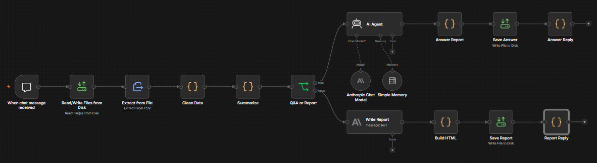
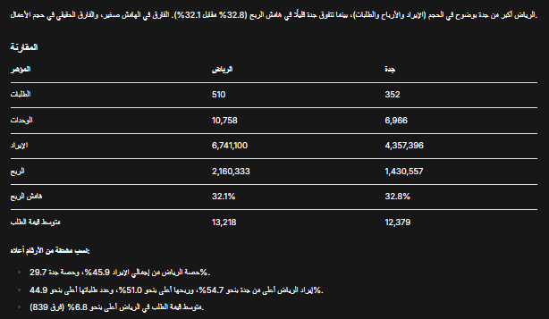
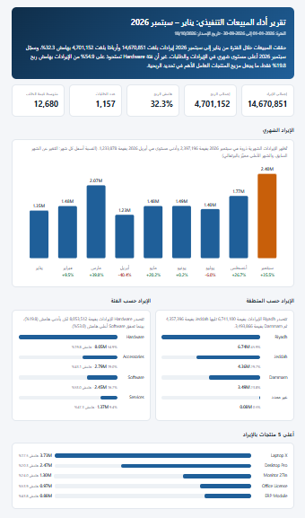
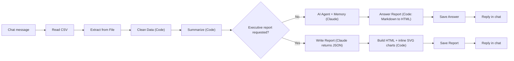

# AI Data Analyst — n8n + Claude

A conversational data analyst and automated executive-report generator built with **n8n**, **Docker** and **Claude (Anthropic)**. Ask questions about a messy sales CSV in Arabic or English and get answers, or ask for an executive report and get a print-ready HTML file with charts.

**نبذة بالعربية:** محلل بيانات ذكي يعمل عبر محادثة. يقرأ ملف مبيعات (CSV) فيه أخطاء متعمدة، ينظّفه ويحسب المؤشرات بالكود، ثم يستخدم Claude لتفسير الأرقام. لكل سؤال يُنتج تقرير HTML جاهزًا للطباعة، وعند طلب "تقرير تنفيذي" يُنتج تقريرًا كاملًا بالرسوم.

---

## Demo

| Workflow | Chat answer | Executive report |
|---|---|---|
|  |  |  |

Sample outputs you can open in a browser: [`sample-outputs/`](sample-outputs/)

---

## What it does

| You type in the chat | What happens |
|---|---|
| Any question, e.g. `Compare Riyadh and Jeddah and give me a recommendation` | Claude answers from pre-computed numbers, and a per-question HTML report (`Answer_<date>_<time>.html`) is saved |
| `executive report` / `تقرير تنفيذي` | A full report with KPI cards, monthly revenue chart, region and category breakdowns, findings, risks, prioritised recommendations and a data-quality section (`Sales_Executive_Report_<date>.html`) |

---

## Architecture



### Design decisions (the interesting part)

1. **Code computes, the LLM interprets.** Every KPI is calculated in JavaScript and handed to Claude as a small JSON summary. Claude is instructed to use only those numbers, so it cannot invent figures. Cards and charts in the report are rendered from the JSON, not from model text.
2. **Flag, don't drop.** The cleaning step marks bad rows with reasons (`bad_date`, `missing_revenue`, `price_outlier`, ...) instead of silently deleting them, and the report discloses how many rows were removed and why.
3. **Price-consistency outlier check.** Revenue is compared with the per-product median unit price; values off by more than 3x are flagged. This catches the x10 revenue errors that a simple range check would miss.
4. **Token-efficient prompting.** The data summary lives in the *System Message*, and the *User Message* holds only the question. Previously the summary was stored in conversation memory on every turn: a test conversation went from **8,458 to 5,057 tokens (about 40% less)**.
5. **LLM outputs JSON, code renders HTML.** The report text comes back as structured JSON (headline, findings, risks, recommendations, data-quality note), validated and rendered by code into a self-contained RTL Arabic HTML page with inline SVG charts, no external dependencies, print-friendly.
6. **Guardrails in the prompt.** Rules such as "no vague fractions like a third or a quarter, use exact percentages", "a title's percentage must match its detail text", and "do not recommend action on gaps under 2 percentage points" came from reviewing real outputs and fixing contradictions.

---

## The data

`data/Sales_Data.csv` is **synthetic**: 1,215 rows (Jan–Sep 2026) across Riyadh, Jeddah and Dammam, 14 products in 4 categories, with deliberately injected problems:

| Problem | Count |
|---|---|
| Missing cells (region, units, revenue, cost, product) | 46 |
| Region formatting issues (case, spaces) | 14 |
| Revenue outliers (x10) | 8 |
| Invalid / extreme units | 6 |
| Negative revenue | 5 |
| Text in a numeric column (`N/A`) | 4 |
| Mixed date formats | 6 |
| Duplicate rows | 15 |

Result of cleaning: 15 duplicates removed, 43 invalid rows excluded, **1,157 valid orders** analysed.

Headline results from the sample run: revenue **14,670,851**, profit **4,701,152**, margin **32.3%** (computed on rows with a known cost). Currency is not specified in the data, so none is assumed.

---

## Setup

**Requirements:** Docker Desktop, an Anthropic API key (console.anthropic.com — separate from a Claude subscription).

1. Create a folder for data and reports, e.g. `C:\n8n-files`, and copy `data/Sales_Data.csv` into it.
2. Run n8n (example for Windows; adjust the path):
   ```bash
   docker run -d --name n8n -p 5678:5678 \
     -v n8n_data:/home/node/.n8n \
     -v C:\n8n-files:/home/node/.n8n-files \
     docker.n8n.io/n8nio/n8n
   ```
   n8n restricts file access to `/home/node/.n8n-files`, which is why the folder is mounted there.
3. Open `http://localhost:5678`, then **Workflows → Import from file** and choose `workflow/ai-data-analyst.json`.
4. Create an **Anthropic** credential with your API key and select it in the two Anthropic nodes (the AI Agent's Chat Model and Write Report). Model used: `claude-sonnet-5-5`.
5. Open the chat panel and ask a question. Reports are saved in your mounted folder.

> The exported workflow contains no credentials. Never commit an API key.

---

## Repository structure

```
n8n-ai-data-analyst/
├── workflow/ai-data-analyst.json     # importable n8n workflow
├── data/Sales_Data.csv               # synthetic, intentionally dirty dataset
├── sample-outputs/                   # example report and per-question answer
├── docs/images/                      # screenshots
└── README.md
```

---

## Limitations

- Runs locally; it stops when Docker or the machine is off.
- The CSV is re-read and re-processed on every message (fine for thousands of rows, not millions).
- Each message calls the Anthropic API and consumes credit; the executive report costs more than a simple question.
- The numbers in cards and charts come from code, but the narrative text is model-written, so review it before sending a report externally.
- Margin percentages use rows with a known cost, so they can differ slightly from total profit divided by total revenue (this is disclosed in the report).

## Roadmap

- [ ] Move cleaning and KPI computation to a **FastAPI + pandas** service in Docker, called from n8n over HTTP
- [ ] Automated check that every number in the model's text exists in the JSON summary
- [ ] Email delivery of the executive report
- [ ] RAG over a data dictionary and business definitions
- [ ] Unit tests for the cleaning rules

---

## Tech stack

n8n · Docker · Anthropic Claude · JavaScript · HTML/CSS · inline SVG

## Author

**Saleh Mahbub** — [github.com/Salehmsa](https://github.com/Salehmsa)
